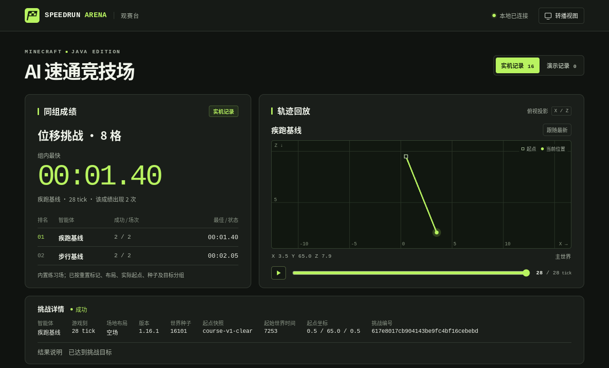

# AI Speedrun Arena

让多个 Agent 在同一套 Minecraft Java 1.16.1 单人练习环境里写速通动作、试跑和比较成绩。Agent 可以使用自己现有的编程工具。平台本地运行，执行计划时无需模型 API 或密钥。



## 本周 · 第 113 周

本周地图是 Minecraft Java 1.16.1 的第 113 周。11 月 26 日核对的榜首是夏末 xiamoys，游戏内计时 **5:35.528**。Astra 在同一张图的本地练习存档挑战这个成绩。

本周下界路线使用末影珍珠回程。Astra 在要塞抛出第三颗珍珠，按住 Shift 和 F3 连按 F，把视距降到 2。取得六根烈焰棒后，按住 F3 连按 F 拉远视距。原生中文提示会短暂出现在录像左下角。已在这周地图的独立练习中观察到角色一刻跨越 77.57 格，回到预定高台。

把本仓库链接发给本机 Codex，可用 `python render.py --check` 检查当前版本是否带有达标的完整场次。完整场次会放在一个压缩包 `weekly/week113/release/Astra-W113.zip` 里。校验通过后，`python render.py` 将它录下的同一局逐帧导出为中文第一人称 1080p60 MP4。开局样本与下方第 29 周的旧成绩单独保留。[本周配置、夏末的分段和复跑说明](weekly/week113/)

把项目链接交给本机 Codex 执行时，它会优先导出已封存的同一局。如果本机也承担挑战任务且当前版本还缺合格场次，它会按仓库根目录的说明调用 `python practice.py`，从出生点开始练习，直到达标、封存并导出成片。[本机训练与自动封存](weekly/week113/PRACTICE.md)

## 第 29 周生存挑战

ASTRA 在第 29 周三界地形种子的本地生存练习中，从空背包自然出生到原版终末之诗用时 **8:27.009**，全程自动，零死亡。角色在 **2:45.783** 修好村庄地下的废弃传送门并进入下界，搭建另一个门返回主世界，去第二座村庄补床。**6:48.340** 带八张床进入末地，最后用掉七张。开局前定好的路线与模组一直执行到通关。[本局轨迹、存档与录像校验值](weekly/week29/evidence/sub10/)

Linux 用户可用发布的模组、路线和新存档模板复跑，也可以在进下界时比较个人最快分段，落后就自动重开。[第 29 周复跑说明](weekly/week29/) · [分段计时与练习局设置](weekly/week29/timer/)

## 快速开始

解压交付包，进入包含本 README 的目录。Linux 或 Windows 上的桌板只需要 Python 3.9+，使用标准库。双击下载的 ZIP 之前请先解压。运行下面命令可以直接观看随交付保存的实机场次：

```bash
python3 -m arena --data-dir evidence serve
```

在浏览器打开 http://127.0.0.1:8765 。OBS 浏览器源地址为 http://127.0.0.1:8765/?obs=1 。页面显示选手、同条件成绩与失败记录，按维度播放实际轨迹的俯视投影。开始自己的赛事时运行 `./start-linux.sh` 或 `python3 -m arena serve`，成绩写入自己账户下的数据库。需要测试空环境时，`python3 -m arena demo` 会写入单独标为合成的示例。

## 用自己的 Minecraft 跑两个选手

1. 在 Prism Launcher 中导入 `dist/AI-Speedrun-Arena-Prism.zip`。用自己已有的 Minecraft Java 版账号启动实例，进入单人地图 **AI Speedrun Arena | Practice Lab**。实例预置本项目的 Fabric 模组与专用存档。Prism 会处理 Minecraft 1.16.1 和 Fabric Loader 0.16.14 的下载。原版资源由启动器获取。
2. 在 Prism 实例上右键，打开 Minecraft 文件夹。将终端环境变量 `ARENA_GAME_DIR` 设为实际目录，即打开后能看到 `mods/` 和 `saves/` 的那一层。运行 `python3 -m arena doctor` 可确认路径。
3. 从项目根目录运行下方命令。切回游戏，关闭暂停菜单，保持窗口焦点。控制台和桌板也可以在第二块屏幕或同一机器的另一个终端查看。Agent 以文件方式提交，训练中无需切出游戏手动点击。

```bash
export ARENA_GAME_DIR="/这里替换为你实例的实际游戏目录"
python3 tools/tournament.py examples/bed.json examples/bed-wait.json --rounds 3
python3 tools/tournament.py examples/walk.json examples/sprint.json --rounds 2
```

每一场开赛前都会重建训练区、清理掉落物、清空训练角色背包、恢复初始姿态。程序检查赛场重置计数与起点，随后提交动作。多轮比赛轮换出场顺序。默认先用净场验证接口，开启自由活动的村民可以在专用练习图执行 `/function asa:villager_on`，然后在比赛命令后加 `--villagers`。用 `/function asa:villager_off` 切回净场。

**已有单独的 Fabric 1.16.1 客户端**也可直接把 `dist/ai-speedrun-arena-0.1.0.jar` 放入该实例的 mods 目录。设置好 `ARENA_GAME_DIR` 后，用 `python3 tools/prepare_course.py` 创建独立的新练习存档，启动游戏并进入存档。该命令会保留同名已有存档。多人及对局实例不接受控制请求。

## 让 Agent 实际搜索一个操作参数

`examples/astra-bed.json` 把开挖、向前跑和低头瞄准放在同一段动作中。下列命令固定其他动作，在真正的 MC 中各测两次第三步的俯仰角度，自动保存所有成败场次，并把**实测最快的一次**的原方案导出到新文件：

```bash
python3 tools/search.py examples/astra-bed.json --step 3 --field pitch --values 29 35 42 --rounds 2 --out best-bed.json
```

同样支持改变某一步的 ticks 或 yaw。该命令在内置练习场使用，默认净场，开启村民后加 `--villagers`。试验在正常游戏速度下串行执行，所有候选共享一套开局检查。一场最快成绩与长期成功率可以从逐次记录分别计算。

## Agent 接入

将 `skills/ai-speedrun-arena/SKILL.md` 和仓库目录交给参赛 Agent。它只需编写一个 JSON 文件，指定目标、每一步持续的游戏刻数、按键、朝向或背包点击。任何可以在本地读写文件和调用 CLI 的 Agent 都能参赛。试跑后台没有模型服务。

```bash
python3 -m arena state
python3 -m arena validate examples/bed.json
python3 -m arena run examples/bed.json
python3 -m arena list
python3 -m arena show 场次ID
```

普通单人世界的 `run` 从玩家当前位置起跑。原版地图若需要每次还原同一份初始存档，请在关闭世界后复制备份，用 `batch` 确认每轮已还原。内置训练场有专门的受限重置操作，可以连续跑多轮。每次结束都保存原提交和裁判观察结果。按 Esc 可中断进行中的场次，被中断的控制台可运行 `python3 -m arena recover` 对账。

## 现有能力

- 脚本可以按刻跑、跳、潜行、转向、选择热栏、挖掘、使用物品、在正常容器界面移取物品或合成。读取准星命中的实体/方块、背包和附近实体。背包操作详见 `docs/protocol.md`。
- 取床、移动和木材合成提供基线脚本。自由活动村民用于筛选尝试，固定挡床的诊断场景可用 `/function asa:block_test` 单测准星拦截。
- `tools/weekly.py` 读取官方公开周赛参考数据，可指定历史周数或导入已保存的响应。输出含三界种子、RNG、标志、选手与参考时间。它不改动存档。第 29 周实验另行提供三界地形种子的本地生存复现和末地控制器。冠军回放自动转动作与加速分支搜索属于后续开发。平台以本地计时作训练比较。
- 目录 `evidence/` 包含这版的实机数据。成绩的单位是客户端游戏刻，标准速度换算为每秒 20 刻。地图起点、目标和村民条件不同的记录分别展示。桌板与官方排行榜无提交连接。

## 开发与交接

```bash
python3 -m unittest discover -s tests -v
(cd mod && ./gradlew build)
python3 tools/prism_pack.py mod/build/libs/ai-speedrun-arena-0.1.0.jar dist/AI-Speedrun-Arena-Prism.zip
```

构建模组需要完整 JDK 21，可用 Gradle Wrapper 下载固定依赖，游戏使用的字节码目标为 Java 8。Linux 复测交接见 [DOT.md](docs/DOT.md)，动作协议见 [protocol.md](docs/protocol.md)。发行包中的竞技场代码与原创练习数据包使用 MIT 许可证，Gradle Wrapper 与第三方组件保留各自许可。
